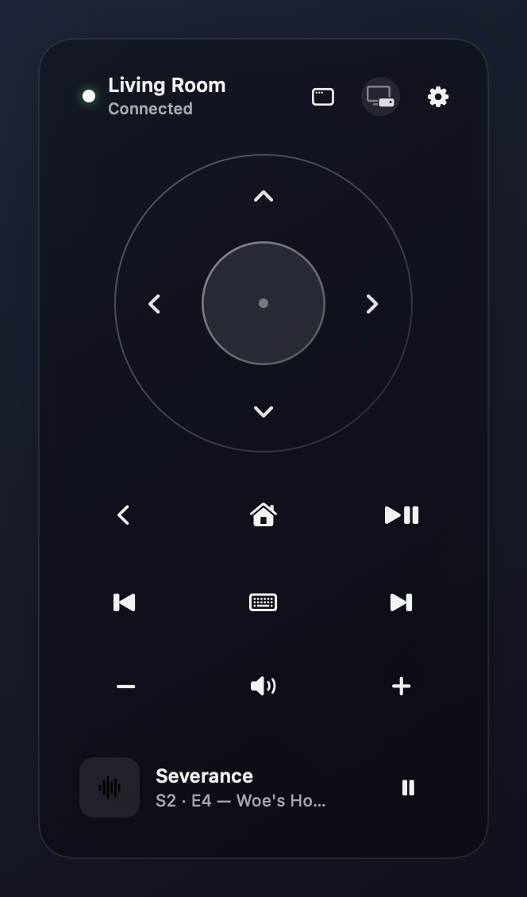
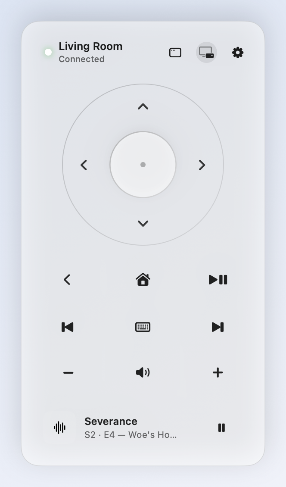
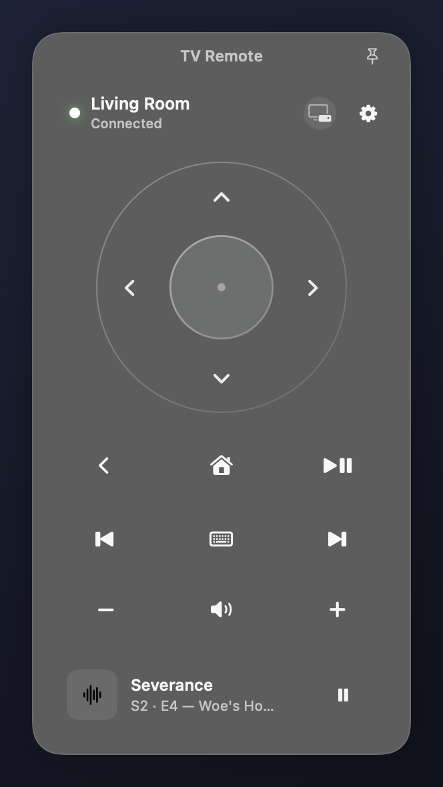

# TV Remote for macOS

**A native macOS Liquid Glass Apple TV remote that lives in both your menu bar and your desktop.**

[](LICENSE)
[](Package.swift)
[](requirements.txt)
[](Package.swift)
[](CHANGELOG.md)

---

## Overview

**TV Remote** gives Mac users, smart-home enthusiasts, and Swift developers a fast, first-party-feeling Siri Remote right on macOS, just an FYI, im not a developer, i vibecoded this app with Gemini 4 argon, I wont be maintaining it, feel free to use it in any way you want.

### Why I Built It

While iPhones and iPads have a built-in Apple TV Remote in Control Center, macOS offers no public framework or native standalone remote app for controlling an Apple TV from your Mac—and reaching for a physical remote or phone just to pause a YouTube video, adjust HDMI-CEC volume, or type a search query breaks flow. **TV Remote** bridges native **Swift 6 + SwiftUI Liquid Glass** with the open-source **`pyatv`** library over a persistent local connection so every button press and keystroke responds instantaneously.

---

## Features

- **Native macOS Liquid Glass Design**: Crafted with `GlassEffectContainer`, `.glassEffect()`, `.buttonStyle(.glass)` / `.glassProminent`, `.glassEffectID`, and `.glassEffectTransition(.materialize)`—no fake blur hacks—with full Light/Dark mode, Reduce Transparency, Reduce Motion, and Increase Contrast support.
- **Dual Menu Bar + Standalone Window**: Use TV Remote as an instant menu bar popover (`MenuBarExtra(.window)`) **and** as a regular macOS window in your Dock (`⌘0`), complete with a one-click **Pop Out (`macwindow`)** button and an optional **Float on Top (`📌`)** pin.
- **Zero-Reconnect Latency**: Runs a long-lived `asyncio` `pyatv` helper (`Companion` + `AirPlay`/`MRP`) over anonymous `stdin`/`stdout` pipes so button presses never pay a reconnect penalty, with automatic crash recovery.
- **Hybrid Bonjour + Unicast Discovery**: Combines macOS `mDNSResponder` (`dns-sd`) with `pyatv` scanning (plus optional `TVREMOTE_DEFAULT_HOST` unicast overrides for segmented smart-home VLANs).
- **Guided In-App Pairing & Keychain Security**: Walks you through the 4-digit PINs displayed on your Apple TV (handling tvOS `BackOff` rate-limit timers automatically) and stores credentials strictly in the encrypted **macOS Keychain**.
- **Complete Siri Remote Controls**:
  - Tactile circular D-Pad (`Up`, `Down`, `Left`, `Right`) with concentric `Select` button
  - **Long-press `Select`** for tvOS context menus & **long-press `Home`** to open **Control Center**
  - `Back / Menu`, `Home`, `Play / Pause`, `Previous Track`, `Next Track`
  - `Volume −`, `Volume +`, and **Smart `Mute`** (stateful save/zero/restore on HomePod/AirPlay, or native Siri Remote USB HID Consumer Mute `0x0C/0xE2` on HDMI-CEC setups)
- **On-Demand Mac Keyboard Capture (`⌨`)**: Click the `⌨` button on the remote to type, `⌫` delete, and `⌘V` paste straight into **YouTube Search** and tvOS text fields (via `CompanionKeyboard` `RemoteTextInput` with automatic USB HID Page `0x07` fallback).
- **Live Now Playing Strip**: Displays real-time media artwork, title, app/artist subtitle, and playback state.
- **Sleep/Network Auto-Reconnect, Global Hotkey & Launch at Login**: Reconnects automatically on Mac wake (`NSWorkspace.didWakeNotification`) or Wi-Fi changes (`NWPathMonitor`), supports a custom system-wide shortcut via Carbon, and integrates with `SMAppService.mainApp`.

---

## Screenshots & Demo

> _Replace or supplement with a live desktop screen recording GIF (`assets/screenshots/demo.gif`) once published._

<p align="center">
  
  
  
</p>

<!-- Live Demo Placeholder:

-->

---

## Prerequisites

- **macOS 26.0+** (macOS 27 recommended for full Liquid Glass rendering)
- **Swift 6.0+** (Xcode 26+ or macOS Command Line Tools)
- **Python 3.11 – 3.13** (e.g. `brew install python@3.12`)
- An **Apple TV HD or Apple TV 4K** on the same local network (or reachable via `TVREMOTE_DEFAULT_HOST`)

---

## Installation & Setup

### Option A: Build Standalone `TV Remote.app` (Recommended)

```bash
# 1. Clone the repository
git clone https://github.com/hudsonmcgrath323-stack/tv-remote-macos.git
cd tv-remote-macos

# 2. Set up the isolated Python environment (~/Library/Application Support/TVRemote/venv)
chmod +x scripts/*.sh
./scripts/setup_python.sh

# 3. Build and sign the standalone macOS app bundle (outputs to ./dist/TV Remote.app)
./scripts/build_app.sh

# 4. Install to /Applications (recommended for Launch at Login) and open
cp -R "dist/TV Remote.app" /Applications/
open "/Applications/TV Remote.app"
```

### Option B: Open in Xcode

```bash
./scripts/setup_python.sh
open TVRemote.xcodeproj
```

Press **⌘R** in Xcode to build and run.

---

## Usage

### 1. Pair with Your Apple TV

1. Wake your Apple TV and launch **TV Remote** (either in its standalone window or by clicking the Siri Remote icon in your macOS menu bar).
2. Select your Apple TV if multiple devices are discovered, then click **Enter TV PIN**.
3. Enter the 4-digit PIN shown on your TV:
   - **Step 1 (`Companion`)**: Enables low-latency navigation, long-press gestures, Control Center, keyboard input, and HID step volume.
   - **Step 2 (`AirPlay` / `MRP`)**: Enables live Now Playing artwork/metadata and HDMI-CEC / absolute mute.

### 2. Remote & Keyboard Shortcuts

When either the standalone window or menu bar popover is active:

| Key / Gesture | Action |
| --- | --- |
| `↑` `↓` `←` `→` | D-Pad Up / Down / Left / Right |
| `Return` | Select |
| Hold `Select` (0.45s) or Right-click | Siri Remote Long-Press Context Menu |
| `Esc` or `Delete` | Back / Menu |
| Hold `Home` (0.45s) or Right-click | Open tvOS Control Center |
| `Space` | Play / Pause |
| `−` / `+` | Volume Down / Volume Up |
| `M` | Toggle Mute |
| Click `⌨` Button | Toggle Live Mac Keyboard Capture (`⌫` Delete, `⌘V` Paste, `⌘⌫` Clear, `Esc` Stop) |
| `⌘0` | Show / Focus Standalone TV Remote Window |

### 3. Preview / Offline Mock Modes

For UI development without a live Apple TV:

```bash
swift run TVRemote --mock-connected
swift run TVRemote --mock-pairing
swift run TVRemote --mock-no-volume
```

---

## Configuration & Environment Variables

TV Remote runs out of the box with zero configuration. For custom Python setups or segmented smart-home VLANs, copy `.env.example` to `.env` (or `~/Library/Application Support/TVRemote/.env`):

```bash
cp .env.example .env
```

| Variable | Default | Description |
| --- | --- | --- |
| `TVREMOTE_PYTHON_BIN` | Auto-detected | Explicit path to a Python 3.11+ binary |
| `TVREMOTE_VENV_DIR` | `~/Library/Application Support/TVRemote/venv` | Path to the isolated `pyatv` virtual environment |
| `TVREMOTE_KEYCHAIN_SERVICE` | `com.hudson.TVRemote.credentials` | macOS Keychain service name storing paired tokens |
| `TVREMOTE_DEFAULT_HOST` | _(unset)_ | Optional comma-separated Apple TV IP(s) for direct unicast scan across VLANs |
| `TVREMOTE_LOG_LEVEL` | `WARNING` | Python helper log level (`DEBUG`, `INFO`, `WARNING`, `ERROR`) |
| `TVREMOTE_BUNDLE_SITE_PACKAGES` | `0` | Build-time flag (`scripts/build_app.sh`): set `1` for local personal builds to copy `site-packages` into `.app` |

---

## Project Structure

```text
tv-remote-macos/
├── .env.example                  # Documented optional environment overrides
├── .github/                      # Issue templates, PR template, and CI workflow
├── Package.swift                 # Swift 6 Package Manager manifest
├── TVRemote.xcodeproj/           # Native Xcode project
├── requirements.txt              # Python bridge dependencies (pyatv, srptools, ifaddr)
├── assets/screenshots/           # Light, Dark, and Standalone Window UI previews
├── docs/
│   ├── ARCHITECTURE.md           # Swift <-> Python JSON-RPC & Liquid Glass design notes
│   └── TROUBLESHOOTING.md        # Pairing, VLANs, HDMI-CEC volume/mute, and TCC tips
├── scripts/
│   ├── setup_python.sh           # Creates isolated Python venv in Application Support
│   └── build_app.sh              # Builds & signs standalone ./dist/TV Remote.app
├── src/
│   ├── Helper/atv_bridge.py      # Persistent asyncio pyatv JSON-RPC bridge
│   └── TVRemote/                 # Swift 6 / SwiftUI application source
│       ├── App/                  # Entry point, AppDelegate, AppState, AppEnvironment
│       ├── Models/               # Device, NowPlaying, and RemoteCommand models
│       ├── Services/             # AppleTVService, PyATVService, BridgeProcessActor, KeychainStore
│       └── Views/                # Liquid Glass Window, Popover, D-Pad, Controls, Pairing, Settings
└── tests/
    └── test_atv_bridge.py        # Unit tests for bridge HID mapping & protocol logic
```

---

## Roadmap

- [ ] App Launcher drawer to jump straight into installed tvOS apps (YouTube, Netflix, Apple TV+, Plex)
- [ ] Trackpad swipe/touchpad gesture mode on the circular D-Pad
- [ ] macOS Shortcuts / App Intents actions (Wake Apple TV, Pause Media, Switch Input)
- [ ] Optional Homebrew Cask formula and notarized GitHub Releases

---

## Contributing

Contributions, bug reports, and feature ideas are welcome! Please read [CONTRIBUTING.md](CONTRIBUTING.md) and our [Code of Conduct](CODE_OF_CONDUCT.md) before opening an issue or pull request.

---

## License

Released under the [MIT License](LICENSE). Copyright © 2026 **Hudson McGrath**.

---

## Acknowledgements

- [**pyatv**](https://pyatv.dev/) by Pierre Ståhl (`postlund`) — the open-source Python client library for Apple TV and AirPlay devices that makes local Companion & MRP control possible.
- Apple's **SwiftUI** & **Liquid Glass** design system.

---

## Author

**Hudson McGrath** — [@hudsonmcgrath323-stack](https://github.com/hudsonmcgrath323-stack)
