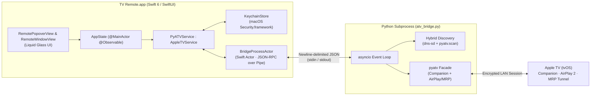

# Architecture Overview

TV Remote splits responsibilities cleanly between a native **Swift 6 / SwiftUI** macOS frontend and a persistent **Python `asyncio` (`pyatv`)** subprocess helper.

---

## 1. Swift Layer (`src/TVRemote/`)

- **`AppleTVService` Protocol (`Services/AppleTVService.swift`)**: Decouples all SwiftUI views from transport details. `PyATVService` drives real hardware, while `MockAppleTVService` powers previews, UI snapshots, and offline development (`--mock-connected`, `--mock-pairing`, `--mock-no-volume`).
- **`BridgeProcessActor` (`Services/BridgeProcessActor.swift`)**: A Swift 6 `actor` that spawns `atv_bridge.py` once and multiplexes concurrent JSON-RPC requests by `UUID` over `stdin`/`stdout` pipes while yielding asynchronous push events (`now_playing`, `audio_update`, `pairing_backoff`, `connection_lost`) over an `AsyncStream`. If the Python process terminates unexpectedly, `BridgeProcessActor` automatically restarts it with exponential backoff.
- **Dual Presentation (`App/TVRemoteApp.swift`, `Views/RemoteWindowView.swift`, `Views/RemotePopoverView.swift`)**:
  - `Window("TV Remote", id: "main-remote")` provides a regular Dock-backed macOS window with behind-window vibrancy and an optional **Float on Top** (`NSWindow.Level.floating`) toggle.
  - `MenuBarExtra(.window)` provides instant popover access from any space or full-screen app.
  - Both surfaces share a single `AppState` and `PyATVService` instance so switching between the menu bar popover and standalone window never reconnects to the Apple TV.

---

## 2. Liquid Glass Compositing Rules

On macOS 26/27, `GlassEffectContainer` merges sibling `.glassEffect()` shapes into a shared refractive lens pass:

1. **Direct Foreground Application**: Always apply `.glassEffect(.regular, in: shape)` directly to the foreground stack (`content.glassEffect(...)`) rather than placing `Color.clear.glassEffect(...)` inside `.background` within a `GlassEffectContainer`, ensuring labels and SF Symbols render above the refractive glass pass.
2. **Concentric Controls (`CircularDPadView`)**: Because `GlassEffectContainer` performs an SDF union across overlapping shapes, concentric controls (outer D-Pad ring + inner Select button) apply `.glassEffect(.regular, in: Circle())` to the outer ring and use elevated specular rimmed surfaces inside it so the inner button stays visually distinct.
3. **Accessibility Fallbacks**: Every glass surface checks `@Environment(\.accessibilityReduceTransparency)`, `@Environment(\.accessibilityReduceMotion)`, and `@Environment(\.colorSchemeContrast)`.

---

## 3. Python Bridge (`src/Helper/atv_bridge.py`)

### Wire Framing
- **Requests** (`stdin`): `{"id": "<uuid>", "cmd": "<name>", "params": {...}}\n`
- **Responses** (`stdout`): `{"type": "response", "id": "<uuid>", "ok": true, "result": {...}}\n`
- **Push Events** (`stdout`): `{"type": "event", "event": "now_playing" | "audio_update" | "pairing_backoff" | "connection_lost", "data": {...}}\n`
- All logging goes strictly to `stderr` so `stdout` remains pure machine-readable JSON.

### Hybrid Discovery (`dns-sd` + `pyatv.scan`)
Some Wi-Fi networks filter raw Python UDP multicast sockets while macOS's system `mDNSResponder` already has live Bonjour records cached. `discover_bonjour_appletv_ips()` queries `/usr/bin/dns-sd -B` / `-L` for `_companion-link._tcp`, `_mediaremotetv._tcp`, and `_airplay._tcp` in parallel with `pyatv.scan()`, then performs fast unicast scans against discovered Apple TV IPs.

### Audio Mute & Keyboard Capture
- **Mute**: Uses stateful save/zero/restore when absolute volume (`SetVolume`) is available (e.g. HomePod/AirPlay), and sends USB HID Consumer Mute (`page=0x0C, usage=0xE2`) over the paired MRP tunnel when the TV uses relative HDMI-CEC step volume.
- **Keyboard Capture**: Uses `CompanionKeyboard` (`RemoteTextInput` `_tiD` session) whenever a native tvOS text field is focused, and falls back seamlessly to USB HID Keyboard/Keypad (`page=0x07`) events over MRP for custom in-app keyboards such as YouTube's search bar.
